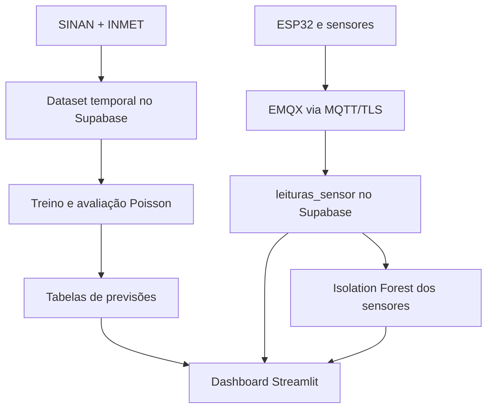

# Arquitetura híbrida

O sistema mantém quatro módulos explicitamente separados. Isso evita alegar que o sensor mede diretamente leptospirose ou que dados simulados representam evidência epidemiológica.

## 1. Camada histórica de modelagem

SINAN e INMET são tratados e relacionados no Supabase. A view privada `tcc_private.dataset_modelagem` materializa, por semana e horizonte, apenas variáveis que estariam disponíveis na data de corte. O treinamento ocorre fora do banco e produz métricas, previsões e artefatos versionados.

## 2. Camada física IoT

O dispositivo mede parâmetros físico-químicos, envia mensagens via internet/MQTT e comprova a integração obrigatória com hardware. Essa camada é validada por conectividade, integridade da mensagem, latência e estabilidade. As leituras servem ao monitoramento operacional e não entram no treino histórico epidemiológico.

## 3. IA exploratória dos sensores

As mudanças consecutivas de pH, turbidez, TDS e temperatura alimentam um
Isolation Forest multivariado. A inferência é causal, não cruza dispositivos,
duplicatas ou lacunas acima de 7min30s e usa um artefato versionado. Seu resultado
é uma sinalização de comportamento incomum, sem significado sanitário.

## 4. Aplicação integrada

O backend e o dashboard apresentam lado a lado:

- risco epidemiológico previsto pelo modelo histórico;
- condições ambientais e meteorológicas;
- telemetria atual do protótipo IoT;
- sinalizações exploratórias da IA dos sensores;
- data de atualização, origem e limitações de cada indicador.

## Bancos e fluxos

O Supabase é a única fonte oficial persistente. O `docker-compose.yml` local sobe somente o broker Mosquitto, evitando um segundo PostgreSQL divergente.

O dashboard não treina o modelo a cada atualização. Ele executa consultas de
somente leitura sobre `tcc_previsoes_operacionais_dashboard`,
`tcc_previsoes_epidemiologicas` e `leituras_sensor`. A primeira fonte alimenta a
visão operacional, a segunda preserva a avaliação final de 2024 e a terceira
recebe a telemetria física. Essa integração ocorre na apresentação e no banco;
não transforma os sensores em atributos epidemiológicos. O dashboard aplica o
artefato do Isolation Forest em memória sobre a telemetria retornada; não grava
inferências e não requer tabela adicional no Supabase.

## Barreiras contra leakage

- chave única: `(horizonte, inicio_semana_t)`;
- `data_corte` é o domingo da semana `t`;
- alvo sempre ocorre após a data de corte;
- `t+1` inicia 7 dias e `t+2` 14 dias após `inicio_semana_t`;
- transformação e imputação são ajustadas somente no treino;
- seleção de modelo usa 2023; 2024 permanece teste final bloqueado;
- métricas são comparadas com baselines ingênuos e sazonais.

## Próxima evolução

Com uma série de campo mais longa e eventos rotulados, a IA dos sensores poderá
ser reavaliada com métricas supervisionadas, calibração por sensor e validação de
falsos positivos. Até lá, permanece exploratória e não substitui a validação
histórica do Poisson.
